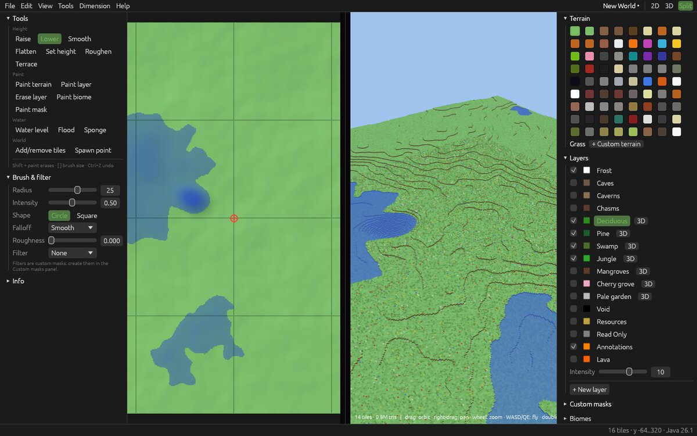
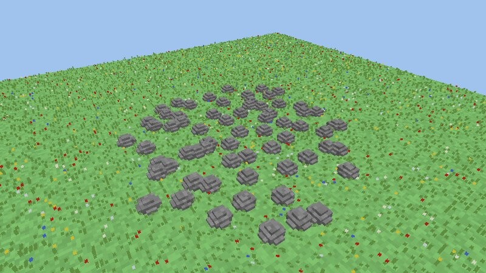
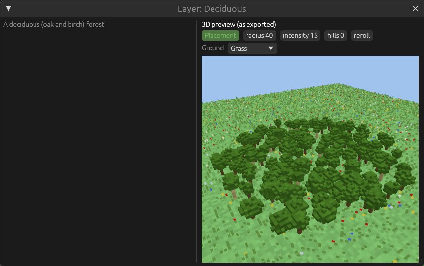
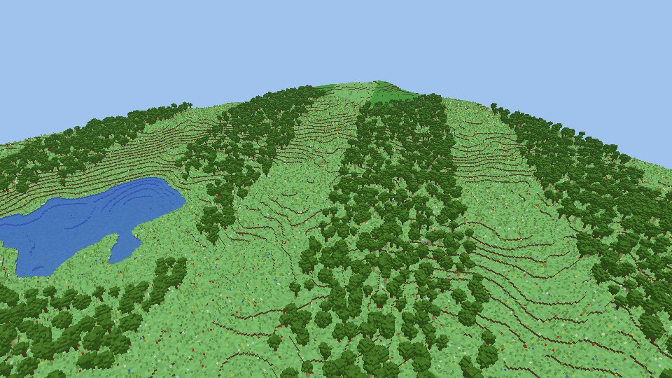
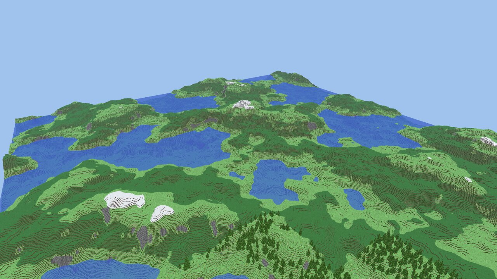

# Meadow

A fast Minecraft terrain editor written in Rust, inspired by [WorldPainter](https://github.com/Captain-Chaos/WorldPainter).
Paint terrain, forests, custom objects and biomes on a map, see the result in a real-time 3D view, and export
Java Edition worlds from 1.18.2 up to 26.1, with build heights up to 4064 blocks.



## Highlights

| | |
|---|---|
| **Real 3D viewport** | GPU (wgpu) renderer with level of detail, frustum culling and background meshing. Trees, custom objects and plants are drawn as actual blocks near the camera. Orbit, pan, zoom, or fly with WASD. |
| **Object placement preview** | Preview any custom object layer (trees, rocks, cliffs, ruins…) in 3D on a sample patch of ground, using the *same* placement code the exporter uses: spacing, density, rotation, mirroring, offsets, water and slope rules. You can also preview a single object on its own. |
| **Custom masks** | Named, reusable masks built from height, slope, terrain, layer, water, biome, noise, images or hand painting. Combine them with all/any/not and soft edges, then use them as brush filters or for whole-map fills. |
| **Height map import + rescale** | 8/16-bit PNG/TIFF/JPEG (grey or a single channel) and `.r16`/`.raw`, with horizontal scale, vertical mapping, bicubic resampling and void cut-off. After import you can still *rescale vertically*, *resize horizontally* or *remap the height range*. |
| **Tall worlds** | Build limits from vanilla (−64..320) up to **−2032..2032 (4064 blocks)**, which is vanilla's hard maximum and what the Higher Heights data pack's biggest variant uses. Meadow generates the height data pack itself, or bundles your Higher Heights `.zip`. |
| **Latest blocks** | All 1,168 blocks and 65 biomes of Minecraft 26.1 (pale garden, resin, copper golem statues, shelves, leaf litter, wildflowers…). Each block records the version it first appeared in, so exports to older versions rename or replace what doesn't exist there. |
| **Conquest Reforged** | All 14,117 `conquest:` block IDs are built in, so you can use them in custom terrains, plants, ground cover and objects. Import the mod jar to pick up the exact block states and texture colours of the version you play. This works for any mod jar, and for the vanilla client jar to get exact colours. |
| **WorldPainter scripts** | Old `.js` scripts run on an embedded QuickJS engine: `wp.*` operations, Java-style `world`/`dimension` methods, `params`, `arguments`, `print`, `Java.type(...)` and the `// script.param.*` descriptors (which become a parameter form). |
| **UI customisation** | UI scale (50–300%), text size, dark/light/system theme, accent colour, corner rounding and compact spacing. Every panel can be placed left, right or hidden and reordered (right-click its header). Settings persist. |
| **Fast exports** | Parallel, lock-free chunk generation. On a 4-core machine a 4096×4096 world (65,536 chunks) exports in about **7 s**; a 1024×1024 world at 4064 blocks tall in about **1.4 s**. |

<p>


</p>
<p>


</p>

## Building

You need Rust 1.88 or newer (`rustup update`).

```bash
cargo build --release
```

Run the editor:

```bash
cargo run --release --bin meadow
```

On Linux you also need the usual windowing libraries (`libxkbcommon`, `libwayland`, X11 libs) and a Vulkan, Metal, DX12 or GL driver. Windows and macOS need nothing extra.

## Using the editor

Meadow uses WorldPainter's controls, map colours and tool names, so WorldPainter users can start straight away. **Help › Controls** (F1) lists them all; [docs/worldpainter-parity.md](docs/worldpainter-parity.md) tracks what matches so far.

* **Mouse (2D map):** left-click or drag applies the tool. Right-click (or Alt+click) does the opposite: lower instead of raise, remove a layer, reset terrain to the height-based theme, or set a biome back to automatic. Middle-drag or Space+drag pans.
* **Wheel:** changes the brush size (Shift: by one block). Ctrl+wheel zooms in powers of two (6.25 %–6400 %) and Alt+wheel rotates the brush.
* **Keys:** `1`–`0` set the intensity in WorldPainter's ten steps, `R`/`L` rotate the hill-shading light, and `[`/`]` resize the brush. Alt+R/P/L/F/H/A/S pick Spray paint, Pencil, Fill, Flood, Height, Flatten and Smooth.
* **Ctrl shortcuts:** Ctrl+N/O/S/E for New, Open, Save and Export, and Ctrl+Z/Y for undo/redo. Ctrl+G opens Global operations and Ctrl+P the world properties. Ctrl+U/H/D switch dimension, Ctrl+V configures the view, Ctrl+3 opens the 3D view and Ctrl+`+`/`−`/`0` zoom.
* **Map look:** WorldPainter's renderer, with hill shading from the chosen light direction, contour lines every 10 blocks, flat water and a 128-block grid with coordinates. On first start Meadow reads block colours from your installed Minecraft (View › Change colour scheme to redo it).
* **3D view** (Ctrl+3): `L`/`R` rotate 90°, `+`/`−` zoom and `0` resets the view. Drag to orbit, right-drag to pan, WASD/QE to fly (Shift for speed), and double-click to focus a point. `Tab` cycles 2D / 3D / split.
* **Layers:** click a layer to paint it. **+ New layer** creates custom objects (load `.schem`, `.schematic`, `.nbt` or `.bo2`), plants, ground cover or terrain overlay layers. **edit** opens the layer editor with its live 3D preview.
* **Custom masks:** build masks in the *Custom masks* panel or from an image, then choose one as the brush **Filter**, or use **Tools › Fill / clear through mask**.
* **Custom terrain:** **+ Custom terrain** in the Terrain panel builds a terrain from any blocks (vanilla, Conquest or imported) as single blocks, random mixes, noise patches or bands, stacked in strata.
* **Export:** **File › Export › Minecraft world** lets you pick the target version, what's generated outside the map, game mode, dimensions, compression and the height data pack.

## Command line

`meadow-cli` does the same work without a window, which is useful for automation and batch jobs:

```bash
meadow-cli new world.meadow --tiles 16 --hills 60 --limits -2032 2032
```

```bash
meadow-cli import heightmap.png world.meadow --scale 200 --height-range 40 900 --limits -64 960
```

```bash
meadow-cli script examples/scripts/snowy_peaks.js --world world.meadow --save out.meadow --param snowLine=140
```

```bash
meadow-cli export out.meadow ~/.minecraft/saves/MyWorld --version 1.20.1 --datapack higher-heights-4064.zip
```

```bash
meadow-cli render out.meadow preview.png --size 1920x1080 --pitch 30
```

```bash
meadow-cli blocks limestone slab --ns conquest
```

## Compatibility notes

**Minecraft versions.** Exports target Java 1.18.2, 1.19.4, 1.20.1, 1.20.4, 1.20.6, 1.21.1, 1.21.4, 1.21.5, 1.21.8, 1.21.10, 1.21.11 and 26.1. Choose **1.20.1** for Conquest Reforged (its current release is for 1.20.1). Lighting is left for Minecraft to compute on first load.

**Build height.** Minecraft limits any dimension to 4064 blocks (y −2032 to 2032), so "4096" in practice means 4064. Meadow can generate the height data pack for 1.18.2–1.21.10. 1.21.11 and 26.1 changed the dimension type format, so for those versions bundle the [Higher Heights](https://modrinth.com/datapack/higher-heights-datapack) pack (Export › Data pack). As with Higher Heights itself, don't remove the data pack from a world once it has been opened.

**WorldPainter scripts.** These work:

* `getWorld`, `createWorld`, `saveWorld` and `exportWorld`;
* `getHeightMap` (with channel selection), `applyHeightMap`, `applyLayer` and `applyTerrain`, including `fromLevel(s)`, `fromColour`, `toLevel(s)`, `toTerrain`, `setWhenLower/Higher`, `scale`, `shift` and `withFilter`;
* `createFilter` (levels, degrees, only/except on terrain/layer/biome/water/land, `withValue().orHigher()/orLower()`), `getLayer().withName()/fromWorld()` and `getBiomeId`;
* the per-column `Dimension` methods (`get/setHeightAt`, `get/setTerrainAt`, `get/setLayerValueAt`, `get/setBitLayerValueAt`, `get/setWaterLevelAt`, `getSlope`, bounds…).

Terrain numbers follow WorldPainter's `Terrain.VALUES`, so `toTerrain(36)` is still Beaches, and biome numbers follow WorldPainter's IDs.

**Not supported yet:**
* reading WorldPainter `.world`, `.layer` and `.terrain` files (they are Java-serialised), including `wp.getWorld().fromFile('x.world')` and `getLayer().fromFile(...)`;
* `mergeWorld`;
* ceiling dimensions;
* arbitrary Java classes beyond a few common shims.

Scripts that only use `.meadow` worlds and layers by name work as-is.

**Conquest Reforged.** The built-in ID list comes from the mod's language file. Blocks are exported without state properties, so Minecraft uses each block's defaults. Import the jar (File › Import › Mod / Minecraft jar blocks) for exact states and colours. Imports are cached and reloaded at start-up.

## Status

Tested here: the unit and integration tests (`cargo test --workspace`); exports read back and decoded; headless 3D renders; and the editor UI driven under a virtual display with software Vulkan and OpenGL. **Not yet tested:** opening exported worlds in a real Minecraft client or server, and running on Windows or macOS. Please report anything that doesn't load.

Known gaps compared with WorldPainter:
* opening `.world` files;
* merging into existing maps;
* the Populate layer for 1.18+;
* custom object block-entity data (chest contents, sign text);
* ceiling dimensions;
* rotating or shifting whole worlds.

## Project layout

| Crate | What it does |
|---|---|
| `meadow-nbt` | NBT reader/writer (gzip/zlib, modified UTF-8). |
| `meadow-blocks` | Block/biome/version registry, Conquest IDs, mod jar import, colours. |
| `meadow-core` | World model (128×128 tiles, copy-on-write undo), terrains, layers, masks, brushes, height maps, schematic loaders, trees, shared placement. |
| `meadow-export` | Anvil exporter, `level.dat`, data packs. |
| `meadow-script` | WorldPainter-compatible scripting (QuickJS). |
| `meadow-render` | wgpu renderer for the 3D view and previews; also works headless. |
| `meadow-app` | The editor (egui). |
| `meadow-cli` | Command line tools. |

`data/vanilla_blocks.tsv` and `data/vanilla_biomes.tsv` are generated from [PrismarineJS/minecraft-data](https://github.com/PrismarineJS/minecraft-data) (MIT) by `tools/gen_vanilla_data.py`.

## License

MIT, see [LICENSE](LICENSE). Meadow is an independent implementation. It isn't derived from WorldPainter's (GPLv3) source code, though it follows WorldPainter's public script API and numbering so existing scripts keep working. It isn't affiliated with WorldPainter, Mojang or the Conquest Reforged team.
